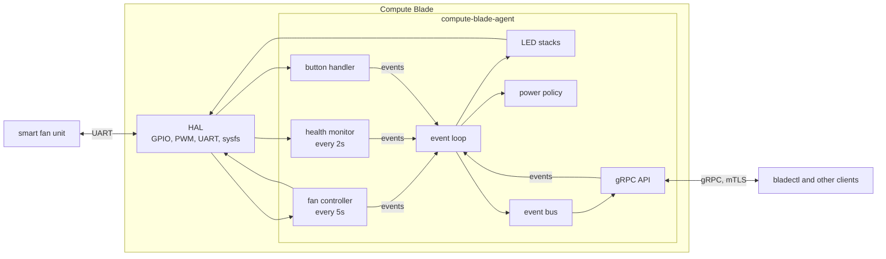

# Architecture

The project has three programs. The **agent** runs on every blade and owns the hardware. **bladectl** is a client
of the agent's gRPC API. The **fan unit firmware** runs on the smart fan unit's microcontroller and talks to two
agents over UART. This page is about the agent.

## The hardware abstraction layer

`pkg/hal` hides the differences between compute modules behind one interface: set the fan speed, read RPM and
temperature, set an LED, read the power source and the firmware throttle flags, and a channel of button transitions.
The agent picks the implementation from the device tree when it starts: BCM2711 (CM4), BCM2712 (CM5) or RK3588
(Radxa CM5). On macOS a simulated HAL lets the agent run without hardware.

The fan unit sits behind the HAL too. A standard fan unit gets PWM from the blade and reports RPM through a tachometer
pin. A smart fan unit gets commands over UART and reports RPM, airflow temperature and button presses back.

## Loops that watch the hardware

The agent runs a few long-lived goroutines. Each owns one job:

| Loop            | Interval     | Job |
|-----------------|--------------|-----|
| fan controller  | 5s           | Read the temperature, check the critical threshold, set the fan speed, check for a stalled fan. |
| health monitor  | 2s           | Read the firmware throttle flags and the power source, raise or clear `undervoltage` and `throttled`, update the power policy. |
| button handler  | on input     | Turn button transitions into gestures and run the bound actions. |
| LED engines     | per pattern  | Play the current blink pattern on each LED. |
| gRPC server     | on request   | Serve the API. |
| discovery       | once         | Register the mDNS service and keep it registered. |

The loops don't change shared state directly. When they notice something, they emit an **event**.

## The event loop

Events go into one buffered channel, and a single goroutine handles them in order. Handling an event updates the
agent's state (identify, critical, raised conditions), switches LED layers and counts the event in
`computeblade_agent_events_count`. Handling events one at a time means two loops can't race over the LEDs or the
state, and the order of events is the order things happened.

Emitting never blocks. If the channel is full, the event is dropped, counted in
`computeblade_agent_events_dropped_count` and logged. A stuck handler can't freeze the fan controller.

After handling, the event goes to the **event bus**, which fans it out to every `WatchEvents` subscriber. Each
subscriber has its own buffer of 64 events, so one slow client doesn't affect the others or the agent.

## LEDs as priority stacks

Several things want the same LED: identify, critical mode, the hold feedback of the button, health indicators. Each
LED has a stack of named layers with priorities (`pkg/ledengine/stack.go`). Activating a layer doesn't overwrite what
another layer shows. The LED shows the highest active layer, and when that layer is deactivated, the next one comes
back. Without the stack, clearing identify would also hide a fan stall indicator that was active underneath.

## State that survives a crash

The agent keeps almost no state on disk. Restarting it resets identify, overrides and conditions, and the detectors
start over. Two things are written:

- `/run/compute-blade-agent/cpufreq-original.json` while the power policy limits the CPU, so the next start can undo a
  limit a crashed agent left behind
- certificates and root's bladectl config in `tcp` mode with mTLS

## Shutdown

On `SIGTERM` the agent stops accepting events, ends open `WatchEvents` streams, restores the original CPU settings,
runs the fan at 100% and switches the LEDs off. Full fan speed is the safe state: once the agent is gone, nothing
watches the temperature anymore.

## Packages

| Package              | Role |
|----------------------|------|
| `cmd/agent`          | Entry point: configuration, logging, metrics server, signal handling |
| `internal/agent`     | The agent: loops, event handling, gRPC API, certificates |
| `pkg/agent`          | Configuration types, defaults and the agent state |
| `pkg/hal`            | Hardware access, one implementation per platform |
| `pkg/events`         | Event types and the event bus |
| `pkg/ledengine`      | Blink patterns, the LED engine and the priority stack |
| `pkg/fancontroller`  | The fan curve and the override |
| `pkg/health`         | Detectors: threshold with hysteresis, flag with clear delay, fan stall |
| `pkg/button`         | The gesture recognizer |
| `pkg/actions`        | Runs built-in actions and commands, one at a time per trigger |
| `pkg/cpufreq`        | Applies and restores cpufreq limits |
| `pkg/discovery`      | mDNS announcement (avahi or built-in) and browsing |
| `pkg/certificate`    | Certificate generation and validation |
| `pkg/smartfanunit`   | The fan unit's UART protocol, shared by agent and firmware |
| `cmd/bladectl`       | The CLI |
| `cmd/fanunit`        | The fan unit firmware (TinyGo) |
